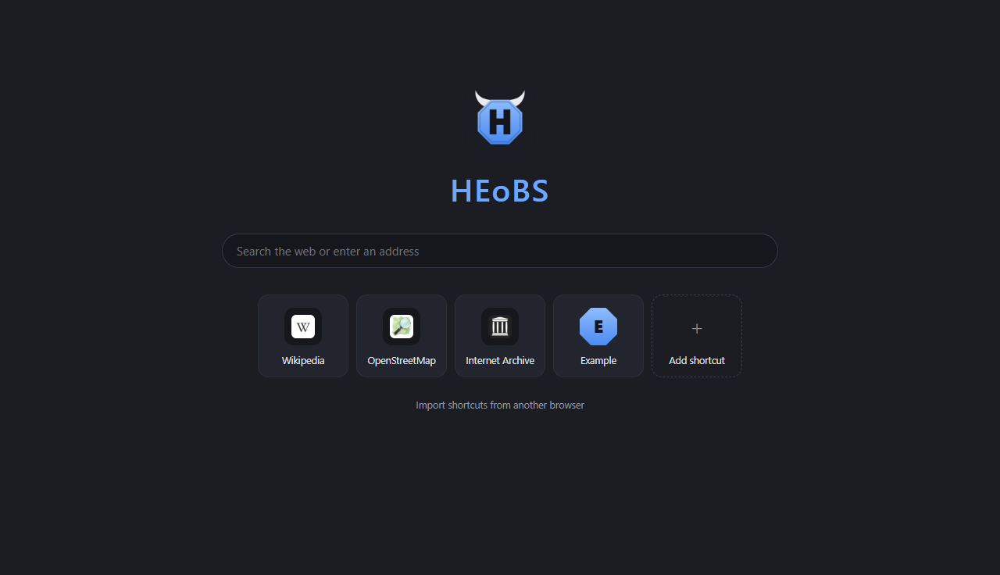

<p align="center">
  
</p>

<h1 align="center">HEoBS</h1>

<p align="center">
  A web browser for Windows that blocks ads, trackers and pop-ups out of the box,<br>
  keeps everything on your own PC, and tells you up front about every connection it makes.
</p>

<p align="center">
  <a href="https://github.com/Gnawbie/HEoBS/releases/latest/download/HEoBS_Setup.exe">
    
  </a>
</p>

<p align="center">
  <a href="https://github.com/Gnawbie/HEoBS/releases/latest">All versions and release notes</a>
</p>

<p align="center">
  
</p>

## Installing

1. Click **Download HEoBS** above and run `HEoBS_Setup.exe`.
2. Choose where to install it. No administrator rights are needed for a per-user install.
3. Start HEoBS from the desktop or Start menu shortcut.

Windows may show an "unknown publisher" warning the first time, because the installer is not code-signed.
Choose **More info → Run anyway** if you trust where you got it.

Uninstalling through Windows keeps your bookmarks, history and passwords.

## What it does

**Blocks the junk**

- Ads, with the gaps they leave hidden, and many "please turn off your ad blocker" walls defused
- Trackers, third-party cookies and tracking tags in links
- Pop-ups a page opens on its own, with per-site exceptions
- Known phishing and malware sites, checked on your PC

**Keeps your data yours**

- No account, no sync, no telemetry. Bookmarks, history and passwords exist only on your PC.
- Saved passwords are encrypted, with a choice of lock: your Windows account, Windows Hello, or a master password.
- History and cookies can clear themselves on a schedule you pick, with trusted sites that stay signed in.
- **Settings → Upfront** lists every connection HEoBS itself makes, why, and how to turn it off.

**Everyday browsing**

- Tabs, bookmarks bar, history, downloads, find in page
- A new tab that leaves the page you were on visible until you press Enter
- A start page with your own shortcuts
- A choice of search engine, including your own
- Import of bookmarks and start-page shortcuts from Chrome, Edge, Brave and others, and of passwords from a CSV export
- Add-ons, each required to show its permissions and trackers before it can be installed

## Optional: Google Safe Browsing

HEoBS protects you with free community lists by default. You can add Google's much larger list on top.
Google only issues the key for this to you personally, so it takes a two-minute setup on your side:
**Settings → Ads & trackers → Google Safe Browsing**, then follow the four numbered steps.
It is free for non-commercial use. HEoBS shows this once in a welcome box the first time you open it.

Addresses are checked on your PC. Google is asked to confirm only when a 4-byte fingerprint matches,
and never receives the address.

## Good to know

- HEoBS runs on the Chromium engine through Electron. Security fixes to that engine arrive only with a new
  HEoBS release, so keep it up to date.
- It does not update itself. New versions appear on the [releases page](https://github.com/Gnawbie/HEoBS/releases).
- The **HEoBS Test** shortcut starts the same browser with an error log, for reporting problems.
- No blocker catches everything, and HEoBS has not been independently audited.

## Building from source

Requires [Node.js](https://nodejs.org/) 22 or newer.

```
npm install
npm start          # run from source
npm run build      # produce HEoBS_Setup.exe
```

## License

HEoBS is freeware: free to use and to share unmodified, not for sale. See [LICENSE.txt](LICENSE.txt).
Third-party components keep their own licenses.
